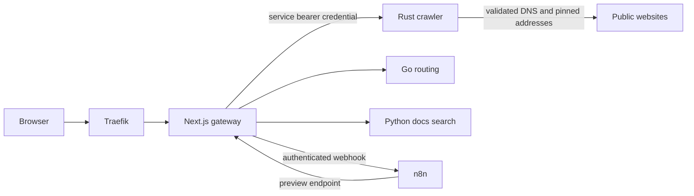

# FlowMeet

A self-hosted B2B lead research and routing prototype, with a reusable Rust permissions library and developer tools.

## Try it

- Application: https://flowmeet.aetherhost.app
- Measured preview: https://flowmeet.aetherhost.app/docs
- Getting started: https://flowmeet.aetherhost.app/guide
- Dependency health: https://flowmeet.aetherhost.app/api/health

The preview reads an allowed company homepage, extracts keyword signals, evaluates Go routing rules, and retrieves a Python documentation entry. Choose a direct run or an authenticated n8n workflow. Both are read-only: **no emails, database writes, or calendar reservations**.

## Architecture



- **Rust / Axum / Tokio:** website fetching, HTML processing, keyword detection, policy checks, metrics, and trace context.
- **flowmeet-permissions:** capability flags, transitive role inheritance, explicit deny precedence, and tenant-bound rules. Missing tenant context fails closed. The full engine allocates; only the bitmask operation is allocation-free.
- **flowmeet-agent-tools:** architecture export, permission simulations, security probes, and a read-only MCP stdio server.
- **Go:** deterministic scoring and routing with a sample representative roster.
- **Python:** TF-IDF retrieval with keyword boosts. No embeddings or language model. Relevance scores are not probabilities.
- **Next.js:** product pages, workspace dashboard, Supabase authentication, and integration endpoints.
- **n8n:** an authenticated three-node workflow that invokes the measured preview and returns its actual result and execution ID. It has no email or persistence nodes.

## Real customer capture

The authenticated `/api/leads` endpoint saves an enquiry before any email attempt. Delivery is explicit (`send_booking_email: true`) and requires a qualified lead, a configured workspace calendar link, and an idempotency key. A separate authenticated n8n customer-capture workflow uses the same implementation. The public preview remains read-only.

A controlled test verified a persisted lead, a real booking email, its signed delivered callback, and an accepted Cal.com booking. See [customer acceptance evidence](docs/customer-acceptance.md) and [the usage guide](docs/user-guide.md). Direct calendar booking is scoped to the configured pilot workspace.

## Run and verify

Docker Compose needs the external `aetherhost-net` network and a private `.env` file. Use `.env.example` as a reference; supply actual Supabase settings for authenticated dashboard features. Generate separate random tokens of at least 32 characters for service authentication, n8n webhook authentication, and n8n encryption.

```sh
docker network create aetherhost-net # once, if absent
docker compose config --quiet
docker compose up -d --build --wait
```

This Compose file is configured for the hosted Traefik gateway. For local access, publish the web service's port 3000 in a Compose override. Backend ports remain private. See [the n8n runbook](docs/n8n.md) for workflow bootstrap and editor access.

```sh
cargo test --workspace --manifest-path crawler/Cargo.toml
cargo clippy --workspace --all-targets --manifest-path crawler/Cargo.toml -- -D warnings
(cd concierge && go test -race ./...)
(cd ai-brain && python3 -m unittest test_retrieval.py)
python3 scripts/test_mcp.py
python3 scripts/smoke.py https://flowmeet.aetherhost.com.ng --n8n
```

Install Python requirements in a virtual environment before the retrieval test. The smoke test makes two actual reads of the default demo website and validates both execution paths; it creates no business records.

## Developer tools

```sh
cargo run --manifest-path crawler/Cargo.toml -p flowmeet-agent-tools -- export-context
cargo run --manifest-path crawler/Cargo.toml -p flowmeet-agent-tools -- lint-policies
cargo run --manifest-path crawler/Cargo.toml -p flowmeet-agent-tools -- verify-action --role viewer --action crawler:scrape --resource domain:example.com
cargo run --manifest-path crawler/Cargo.toml -p flowmeet-agent-tools -- serve-mcp
```

`serve-mcp` supports initialization, ping, discovery, architecture context, and permission simulation over newline-delimited JSON-RPC. Simulation grants no real access. The stdio transport follows the [MCP transport specification](https://modelcontextprotocol.io/specification/2024-11-05/basic/transports).

## Deployment and rollback

`deploy.sh` syncs source without copying local environment files, builds the stack, waits for health, and runs the read-only smoke test. The deployment directory is `/srv/flowmeet-platform`. Runtime credentials are held only on the server. The `.com.ng` route has a unique name; the separately managed `.app` deployment is independent.

See [the case study](docs/platform-case-study.md) and [operations guide](docs/operations.md). The crawler Helm chart was exercised in an isolated kind/Calico Kubernetes cluster, including network-policy checks and rollback. The public application still runs on Compose. Flux reconciliation was not exercised.

## Limitations

- Company size, technologies, qualification, and tier values are heuristic signals, not verified firmographics or revenue forecasts.
- Routing includes placeholder representatives. A booking link does not reserve a meeting.
- The preview does not validate customer writes. Controlled acceptance separately verified persistence, email delivery, and pilot booking. CRM writes and calendar cancellation/reschedule synchronisation remain unverified.
- Cache and demo rate limits are process-local, reset on restart, and are not a distributed abuse-control system.
- Internal service credentials identify the gateway, not individual end users. Tenant-bound policy simulations are separate from the gateway's trusted operator role.
- Tests and measurements apply to the tested revision and environment. Historical speed and memory claims have been removed rather than presented as current measurements.
