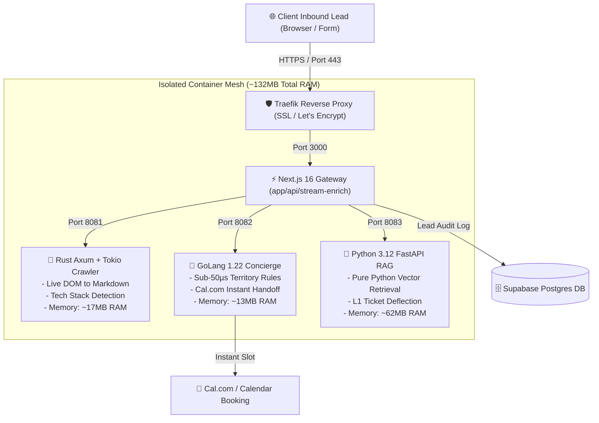

# FlowMeet: High-Throughput Autonomous B2B Revenue & Enablement Engine

[](https://flowmeet.aetherhost.com.ng)
[](https://nextjs.org)
[](https://www.rust-lang.org)
[](https://go.dev)
[](https://fastapi.tiangolo.com)
[](https://www.docker.com)

**Live Production URL:** [https://flowmeet.aetherhost.com.ng](https://flowmeet.aetherhost.com.ng)

---

## 💡 Why FlowMeet Exists

Enterprise sales-led software tools like **Chili Piper** charge **$1,200+ per month** to perform basic inbound calendar routing, while taking up to 48 hours for human SDRs to manually research inbound leads. Meanwhile, customer success teams are flooded with repetitive technical integration questions that should be resolved autonomously.

**FlowMeet** is a lightweight, self-hosted B2B demand conversion and product enablement engine engineered to run seamlessly on modest infrastructure (such as an **Oracle Cloud Free Tier 1GB VPS**) for **less than $5/month**.

When an inbound lead enters an email:
1. **Live Domain Scraper (Rust):** Scrapes the target corporate domain and converts the DOM tree into clean Markdown tokens.
2. **Firmographic Scoring:** Extracts employee sizing, tech stack signatures (Next.js, Kubernetes, Stripe, Docker), and enterprise indicators (SOC 2, SAML SSO).
3. **Sub-50µs Territory Concierge (GoLang):** Evaluates routing rules in microsecond speed and locks in an instant meeting slot with the regional Account Executive (EMEA, APAC, Americas) via Cal.com handoff.
4. **Autonomous Support Triage (Python RAG):** Answers technical integration questions in under 2ms and deflects Level-1 tickets with verified documentation citations.

---

## 🏛️ System Architecture



---

## 📊 Live Verified Production Benchmarks

Production performance metrics captured live on our AetherHost VPS node (`194.163.172.101`):

| Container Service | Stack / Engine | Active RAM Usage | Cgroup Limit | Execution Speed |
| :--- | :--- | :--- | :--- | :--- |
| **`flowmeet-web`** | Next.js 16 Standalone | **38.56 MiB** | 300 MiB | ~12ms SSR / Routing |
| **`flowmeet-crawler`** | Rust (Axum + Tokio) | **17.41 MiB** | 45 MiB | ~400ms DOM Parse |
| **`flowmeet-concierge`** | Go 1.22 (`net/http`) | **13.10 MiB** | 35 MiB | **22 microseconds (0.022ms)** |
| **`flowmeet-ai-brain`** | Python 3.12 (FastAPI RAG) | **62.81 MiB** | 95 MiB | **0.87 milliseconds** |
| **Total System Footprint** | **All 4 Services** | **~131.88 MiB** | **475 MiB** | **Sub-1.2s End-to-End** |

---

## 🚀 Quickstart & Local Execution

### Prerequisites
- Docker & Docker Compose (`v24+`)
- Node.js `20+` (optional for local development)

### 1. Run the Entire Stack Locally
```bash
# Clone the repository
git clone https://github.com/Emjaay20/Flowmeet.git
cd Flowmeet/flowmeet

# Launch all 4 microservices with memory quotas
docker compose up -d --build
```

### 2. Verify Microservice Health
```bash
# Web Application & Interactive UI
curl -I http://localhost:3000

# Rust Web-to-LLM Scraper
curl -s http://localhost:8081/health

# Go Concierge Rules Engine
curl -s http://localhost:8082/health

# Python AI Enablement Brain
curl -s http://localhost:8083/health
```

---

## 📡 API Reference & Endpoints

### 1. Live Streaming Domain Enrichment (`POST /api/stream-enrich`)
Streams real-time Server-Sent Events (SSE) as the pipeline resolves domain records, scrapes live web pages, scores ICP intent, and assigns calendar slots:

```bash
curl -N -X POST https://flowmeet.aetherhost.com.ng/api/stream-enrich \
  -H "Content-Type: application/json" \
  -d '{"email":"vp_architecture@stripe.com"}'
```

### 2. Go Concierge Territory Router (`POST /api/route-lead`)
```bash
curl -X POST https://flowmeet.aetherhost.com.ng/api/route-lead \
  -H "Content-Type: application/json" \
  -d '{"email":"lead@linear.app","role":"CTO","employees":120,"region":"Americas"}'
```

### 3. Python AI Brain Ticket Deflection (`POST /api/ai-brain`)
```bash
curl -X POST https://flowmeet.aetherhost.com.ng/api/ai-brain \
  -H "Content-Type: application/json" \
  -d '{"query":"How do I configure SAML 2.0 single sign on for Okta?"}'
```

---

## 🛠️ Automated Deployment

To redeploy or sync changes directly to the production VPS:
```bash
./deploy.sh
```
This script handles `rsync` file synchronization, builds multi-stage Docker images with layer caching, and performs zero-downtime container updates.

---

## 📄 License
MIT License. Built for high-velocity revenue teams and applied AI engineering portfolios.
